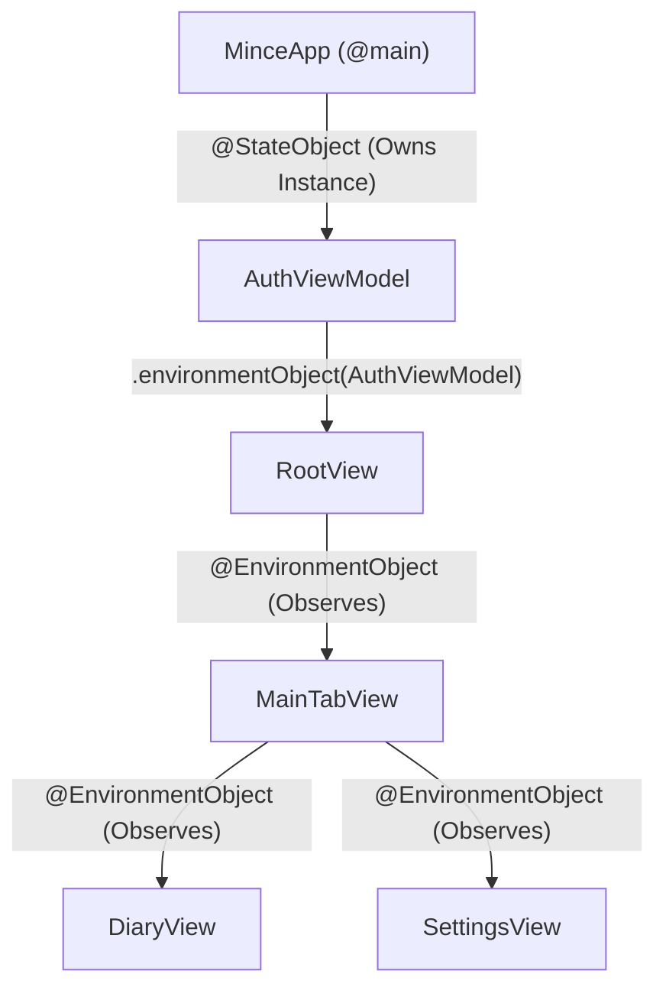
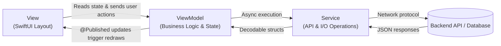
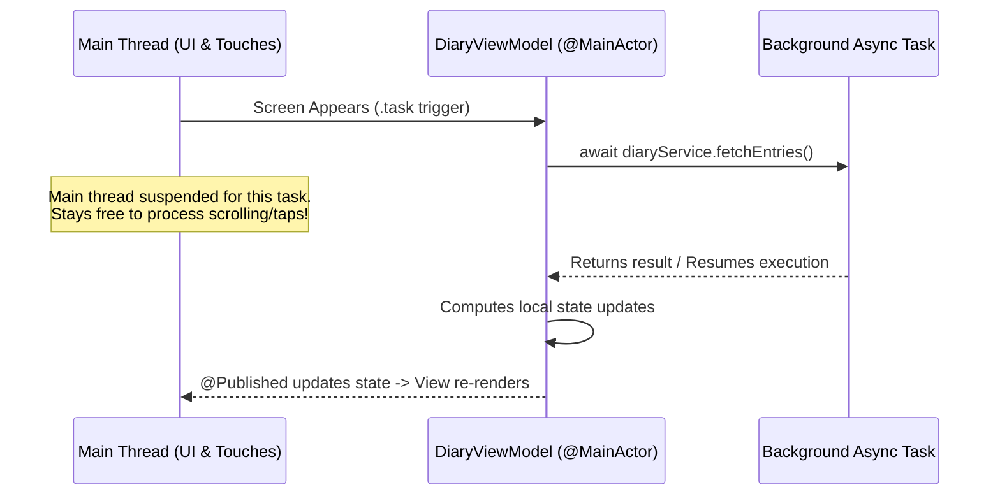
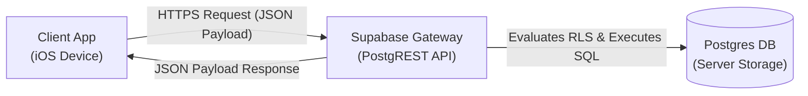
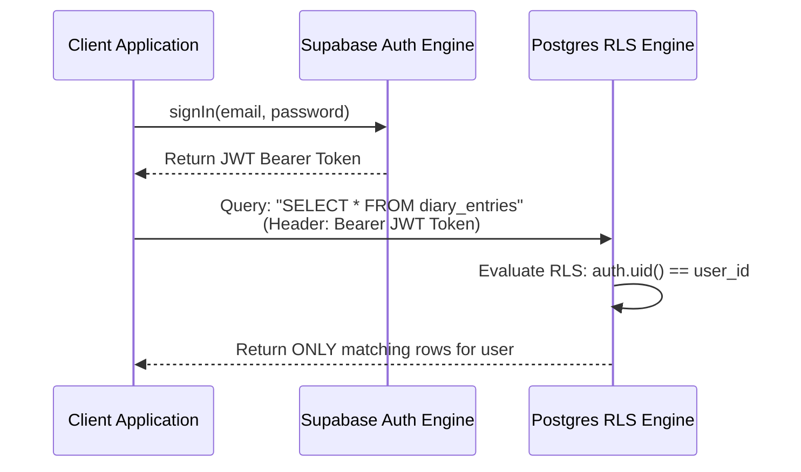
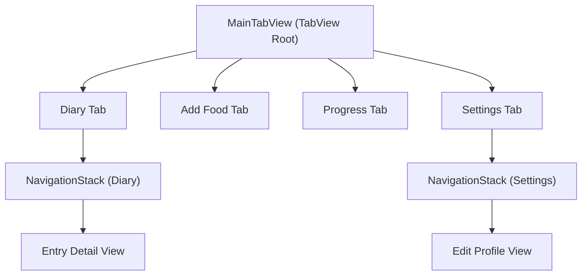

# Core Concepts

This guide walks through the core ideas behind iOS development from first principles. It covers not just Swift syntax, but the underlying engineering decisions—why apps are structured the way they are, how data flows through them, and how local client code interfaces with backend servers.

Each section ends with an **In `mince`:** reference pointing directly to the project's source code so you can trace these abstract concepts to implementation.

---

## 1. What is an "app," really?

An app is an executable binary program running on a mobile operating system (iOS). Three main characteristics distinguish a mobile app from a command-line script or background utility:

```
┌─────────────────────────────────────────────────────────────────┐
│                        iOS Operating System                     │
│                                                                 │
│   ┌────────────────┐   ┌───────────────────┐   ┌────────────┐   │
│   │ App Entry      │───│  SwiftUI Engine   │───│ Main Loop  │   │
│   │ (@main)        │   │  (Renders UI)     │   │ (Taps/Evts)│   │
│   └────────────────┘   └───────────────────┘   └────────────┘   │
└─────────────────────────────────────────────────────────────────┘
```

* **Graphical User Interface (GUI):** Instead of text outputs, the app relies on a UI framework (SwiftUI) to define visual elements—buttons, labels, scrolling lists—and handle hardware input events (taps, drags, pinches).
* **OS-Managed Lifecycle:** Unlike standard programs where execution starts at `main()` and terminates at exit, mobile apps are managed continuously by the OS. iOS determines when your app launches, pauses, resumes in the background, or terminates. In SwiftUI, the `@main` attribute marks the entry point.
* **Ahead-of-Time (AOT) Compilation:** Swift code is compiled into native machine code (a binary bundle) by Xcode’s compiler (`swiftc`) before running. This architecture catches structural errors—such as type mismatches or unhandled execution paths—at build time rather than runtime.

> **In `mince`:** [`Sources/mince/MinceApp.swift`](Sources/mince/MinceApp.swift)  
> This file houses the `@main` attribute. The main window structure defined inside its `body` acts as the root render pass for the entire application.

---

## 2. Core Swift Language Concepts

Swift provides specific language primitives designed to balance safety, performance, and explicit system design:

```
                    ┌───────────────────────────┐
                    │      Swift Type System    │
                    └─────────────┬─────────────┘
                                  │
         ┌────────────────────────┴────────────────────────┐
         ▼                                                 ▼
┌───────────────────┐                             ┌───────────────────┐
│    Value Types    │                             │  Reference Types  │
│     (struct)      │                             │      (class)      │
├───────────────────┤                             ├───────────────────┤
│ • Copied on pass  │                             │ • Shared instance │
│ • Single owner    │                             │ • Multi-pointer   │
│ • Thread-safe     │                             │ • State mutation  │
└───────────────────┘                             └───────────────────┘
```

* **Static & Strong Typing:** Variables are locked to a declared type at compile time. The compiler prevents type-coercion bugs before code runs on a user's device.
* **`struct` (Value Type) vs. `class` (Reference Type):**
  * `struct`: Copied when passed around (copy-on-write semantics). Every instance maintains an independent state, eliminating unintended shared mutation side effects. SwiftUI views and underlying data models use structs.
  * `class`: Passed by reference. Multiple parts of your code point to the exact same object in memory. Used for long-lived objects that manage state across views (such as ViewModels).
* **Enumerations (`enum`):** Strongly-typed options representing a fixed set of possibilities. Enums eliminate loose strings and allow compile-time enforcement of exhaustive checks via `switch` statements.
* **Optionals (`Type?`):** Swift enforces explicit handling of missing values. An Optional either contains a value (`Some(T)`) or contains nothing (`none`/`nil`). This prevents null-pointer runtime crashes at the language level by requiring explicit unwrapping (`if let`, `guard let`, or `??`).
* **Protocols:** Contracts that define standard methods, properties, or capabilities without enforcing concrete implementation details. Protocols enable loose coupling and dependency injection (such as swapping production service calls with mock implementations for testing).

> **In `mince`:** 
> * Value model: [`Sources/mince/Models/Food.swift`](Sources/mince/Models/Food.swift) (`struct`)
> * Strictly-typed enum: [`Sources/mince/Models/DiaryEntry.swift`](Sources/mince/Models/DiaryEntry.swift) (`MealType`)
> * Optionals usage: [`Sources/mince/Models/UserProfile.swift`](Sources/mince/Models/UserProfile.swift) (handles partial user fields)
> * Protocol abstraction: [`Sources/mince/Services/FoodPhotoEstimationService.swift`](Sources/mince/Services/FoodPhotoEstimationService.swift)

---

## 3. Declarative UI vs. Imperative UI

SwiftUI shifts UI management from an *imperative* model to a *declarative* model.

```
Imperative (Legacy UIKit)
┌─────────────┐      Find View       ┌───────────────┐      Mutate State      ┌─────────────┐
│ Event Occurs│ ───────────────────> │ Find Label    │ ─────────────────────> │ Change Text │
└─────────────┘                      └───────────────┘                        └─────────────┘

Declarative (SwiftUI)
┌─────────────┐     Update Model     ┌───────────────┐     Compute Diff       ┌─────────────┐
│ Event Occurs│ ───────────────────> │ Data Changes  │ ─────────────────────> │ UI Re-renders│
└─────────────┘                      └───────────────┘                        └─────────────┘
```

* **Imperative UI (UIKit/AppKit):** You write step-by-step logic to mutate views manually: locate a target label, modify its text property, toggle visibility, and adjust layout constraints when underlying data changes. Manual tracking of UI states often causes UI desynchronization bugs.
* **Declarative UI (SwiftUI):** You define a functional mapping of your UI state: UI = f(Data). You describe *what* the screen should look like given the current data state, and SwiftUI automatically handles diffing, layout passes, and DOM-like view graph re-renders.

A SwiftUI `View` is a lightweight structure describing a region of screen layout. Returning `some View` uses opaque return types to tell the compiler: *"this body yields a specific visual type conforming to `View`, but you handle the concrete type resolution."*

> **In `mince`:** [`Sources/mince/Views/Diary/DiaryView.swift`](Sources/mince/Views/Diary/DiaryView.swift)  
> The `List` block continuously reflects `viewModel.entries`. Modifying the underlying data collection automatically triggers a minimal visual refresh pass.

---

## 4. State Management and Property Wrappers

To bind data changes directly to layout updates, SwiftUI uses language **property wrappers** to explicitly signal data ownership and observation boundaries.

| Property Wrapper | Primary Location | Data Ownership | Target Use Case |
| :--- | :--- | :--- | :--- |
| **`@State`** | `View` struct | Current View | Local transient state (e.g., text inputs, toggle states, expand/collapse toggles). |
| **`@Published`** | `ObservableObject` class | View Model / Service | Class properties that publish modification signals to active listeners. |
| **`@StateObject`** | `View` struct | Current View | **Creates and owns** a long-lived class object across UI redraw cycles. |
| **`@ObservedObject`** | `View` struct | Parent View | Receives and watches an external `ObservableObject` instantiated elsewhere. |
| **`@EnvironmentObject`** | `View` struct | Application Hierarchy | Global state injected via root tree nodes to avoid manual property drilling. |

### Single Source of Truth

To prevent synchronization drift across multiple views, every piece of mutable state must have exactly **one owner**.



> **In `mince`:** 
> * Publisher: [`Sources/mince/ViewModels/AuthViewModel.swift`](Sources/mince/ViewModels/AuthViewModel.swift) uses `@Published` on `session`.
> * Instantiation: [`Sources/mince/MinceApp.swift`](Sources/mince/MinceApp.swift) uses `@StateObject` to own the instance and injects it via `.environmentObject(...)`.
> * Environment Consumption: [`Sources/mince/Views/Root/RootView.swift`](Sources/mince/Views/Root/RootView.swift) consumes this instance with `@EnvironmentObject`.

---

## 5. Architectural Pattern: Model-View-ViewModel (MVVM)

As application complexity scales, placing business logic directly inside views degrades maintainability, blocks testability, and violates separation of concerns. The MVVM architecture resolves this by enforcing unidirectional data flow:



* **Model:** Immutable data structures that define your domain types (e.g., `Food`, `DiaryEntry`). Models contain no business logic or framework code.
* **View:** Declarative code responsible for presentation and layout. Views read state from ViewModels and relay user actions back to them. Views never execute business logic or issue direct network calls.
* **ViewModel:** The mediator between domain data and presentation. It holds the UI state (`@Published` variables), executes domain business logic (e.g., total aggregate calculations), and routes requests to service layers.
* **Service:** Dedicated operational layer handling I/O processes—such as HTTP networking, database queries, and device hardware interactions.

> **In `mince`:**
> * Model: [`Sources/mince/Models/DiaryEntry.swift`](Sources/mince/Models/DiaryEntry.swift)
> * ViewModel: [`Sources/mince/ViewModels/DiaryViewModel.swift`](Sources/mince/ViewModels/DiaryViewModel.swift)
> * View: [`Sources/mince/Views/Diary/DiaryView.swift`](Sources/mince/Views/Diary/DiaryView.swift)  
> The view contains no backend network logic; it communicates solely through calls to `DiaryViewModel`.

---

## 6. Asynchronous Programming with `async`/`await`

Mobile operating systems render UI frames on a single primary thread: the **Main Thread** (running at 60Hz or 120Hz). Executing long-running tasks like network calls or disk I/O synchronously on the main thread blocks screen redrawing, causing frozen UIs and dropped frames.



Swift handles non-blocking tasks using an explicit concurrency model:

* **`async`:** Marks a function as asynchronous, signaling that it can suspend execution while waiting for long-running operations to finish.
* **`await`:** Designates an explicit suspension point. The runtime pauses the execution of the current method without blocking the underlying thread, allowing the main thread to remain responsive to user inputs.
* **`throws` / `try`:** Explicit error handling. Functions that can fail must be marked `throws` and invoked using `try`.
* **`@MainActor`:** A global actor attribute enforcing that marked code (classes, properties, or functions) executes exclusively on the main thread. ViewModels are annotated with `@MainActor` so state updates safely drive the UI.

> **In `mince`:**
> * Async Service execution: [`Sources/mince/Services/DiaryService.swift`](Sources/mince/Services/DiaryService.swift) uses `async throws` for API network calls.
> * Main Thread Enforcement: [`Sources/mince/ViewModels/DiaryViewModel.swift`](Sources/mince/ViewModels/DiaryViewModel.swift) uses `@MainActor` to safely execute UI state updates.

---

## 7. Client-Server Architecture & API Networking

Applications split core responsibilities between a local **client** (the user's device) and a **backend server** (central database, authentication, and heavy business logic).



* **REST APIs & HTTP Verbs:** Communication happens over standard HTTPS requests targeting defined endpoint paths using explicit operations:
  * `GET`: Fetch resources.
  * `POST`: Create new resources.
  * `PATCH`/`PUT`: Update existing resources.
  * `DELETE`: Remove resources.
* **Data Serialization (`Codable`):** Servers exchange data using **JSON** text payloads. Swift's `Codable` protocol automatically serializes native Swift structures into JSON payloads for requests and decodes JSON responses back into strongly-typed models.
* **Backend as a Service (BaaS):** Instead of building and deploying a custom server application, `mince` integrates with **Supabase**. Supabase exposes auto-generated REST endpoints over a PostgreSQL database via PostgREST, converting Swift client calls directly into database queries safely.

> **In `mince`:**
> * Base Client Engine: [`Sources/mince/Services/SupabaseService.swift`](Sources/mince/Services/SupabaseService.swift) maintains the shared connection instance.
> * Database Queries: [`Sources/mince/Services/FoodService.swift`](Sources/mince/Services/FoodService.swift) maps local Swift calls directly into remote database table requests.

---

## 8. Database Architecture and Data Persistence

To preserve user data across app restarts or hardware changes, records are stored in a persistent database. `mince` relies on a **Relational Database Management System (RDBMS)** powered by PostgreSQL.

### Relational Schema Principles

* **Tables:** Data is divided into discrete entities structured as rows and columns.
* **Primary Key (PK):** A unique identifier (UUID) assigned to every individual row in a table.
* **Foreign Key (FK):** A database column that points directly to the Primary Key of another table, forming explicit relationships between entities.

```mermaid
erDiagram
    AUTH_USERS ||--|| PROFILES : "has one"
    AUTH_USERS ||--o{ DIARY_ENTRIES : "owns many"
    AUTH_USERS ||--o{ WEIGHT_LOGS : "owns many"
    AUTH_USERS ||--o{ FOODS : "creates (optional)"
    FOODS ||--o{ DIARY_ENTRIES : "referenced by"

    AUTH_USERS {
        uuid id PK
    }
    PROFILES {
        uuid id PK_FK
    }
    FOODS {
        uuid id PK
        uuid created_by FK
    }
    DIARY_ENTRIES {
        uuid id PK
        uuid user_id FK
        uuid food_id FK
    }
    WEIGHT_LOGS {
        uuid id PK
        uuid user_id FK
    }
```

> **In `mince`:**  
> Refer to [`supabase/migrations/`](supabase/migrations/) for migration scripts. For instance, `0003_diary_entries.sql` uses `food_id uuid references public.foods (id)` to create a foreign key relationship linking diary entries to specific foods.

---

## 9. Authentication, Sessions, and Row Level Security (RLS)

Identity management requires strict separation between verification (**Authentication**) and permission bounds (**Authorization**).



1. **Authentication:** The client sends credentials (e.g., email/password) once during login. Upon verification, the auth provider returns a cryptographically signed **JWT Session Token**. The client attaches this token to the Authorization header of every subsequent HTTP request.
2. **Authorization & Row Level Security (RLS):** Instead of relying on client apps to filter data locally, database security policies enforce authorization rules directly on the server. PostgREST runs SQL policies like `auth.uid() = user_id` for every query. The database engine itself rejects access to unauthorized rows, even if a compromised client requests all database records.
3. **Secret Security:** Sensitive credentials (such as API secret keys) are kept out of source code repositories. Secrets are loaded dynamically using environment configurations (`.xcconfig`) excluded via `.gitignore`.

> **In `mince`:**
> * RLS SQL Declarations: [`supabase/migrations/0003_diary_entries.sql`](supabase/migrations/0003_diary_entries.sql)
> * Client Auth Session Tracking: [`Sources/mince/ViewModels/AuthViewModel.swift`](Sources/mince/ViewModels/AuthViewModel.swift)
> * Security Pattern: [`Secrets.xcconfig.example`](Secrets.xcconfig.example) demonstrates how local secrets are kept out of version control.

---

## 10. Dependency Management with Swift Package Manager (SPM)

Modern apps rely on external open-source libraries to handle complex features without reinventing existing tools.

* **Package Manager:** A tool that automates fetching, compiling, and updating third-party libraries while tracking version dependencies.
* **Swift Package Manager (SPM):** Apple's native dependency manager integrated directly into Xcode. SPM reads a project configuration, fetches source code repositories from version control (Git), and links compiled modules into your app target.

```
┌────────────────────────────────────────────────────────┐
│                      Xcode Project                     │
│                                                        │
│  ┌───────────────────────────┐                         │
│  │ Local App Target (mince)  │                         │
│  └─────────────┬─────────────┘                         │
│                │ imports module                        │
│                ▼                                       │
│  ┌───────────────────────────┐                         │
│  │ Swift Package Manager     │                         │
│  │ (supabase-swift)          │                         │
│  └───────────────────────────┘                         │
└────────────────────────────────────────────────────────┘
```

> **In `mince`:**  
> The `supabase-swift` package is imported via SPM to handle authentication, PostgREST queries, and database serialization. References appear as `import Supabase` across the [`Sources/mince/Services/`](Sources/mince/Services/) directory.

---

## 11. Application Navigation Architecture

App architecture requires a clear strategy for structural transitions and navigation hierarchies across screens:



* **Tab Navigation (`TabView`):** Top-level navigation structure managing distinct, non-hierarchical application domains. Switching tabs preserves screen state within each branch.
* **Stack Navigation (`NavigationStack`):** A drill-down presentation pattern managing push/pop transitions in a linear path. New screens are pushed onto the view stack with back controls provided automatically.

> **In `mince`:**
> * Root Navigation Controller: [`Sources/mince/Views/MainTabView.swift`](Sources/mince/Views/MainTabView.swift)
> * Stack Container: [`Sources/mince/Views/Diary/DiaryView.swift`](Sources/mince/Views/Diary/DiaryView.swift) embeds its screen layout inside a local `NavigationStack`.

---

## 12. Compilation, Build Targets, and Execution

To run code on a hardware device or software emulator, raw Swift source files must pass through the compilation process:

```
┌──────────────┐      Compile (swiftc)      ┌──────────────┐      Bundle Assets      ┌───────────────┐
│ Swift Source │ ─────────────────────────> │ Machine Code │ ──────────────────────> │  App Bundle   │
│ (.swift)     │                            │ (Binary)     │                         │  (.app)       │
└──────────────┘                            └──────────────┘                         └───────────────┘
                                                                                             │
                                                                                    Install & Run
                                                                                             │
                                                                                             ▼
                                                                                     ┌───────────────┐
                                                                                     │ iOS Simulator │
                                                                                     │ / Device      │
                                                                                     └───────────────┘
```

* **Target:** A defined project build configuration in Xcode that produces a single executable bundle. It specifies compiler flags, dependencies, deployment targets, and build settings.
* **Deployment Target:** The minimum iOS version required to install and run the app (e.g., iOS 17.0+). The compiler uses this target to check that all APIs used in the application are available on supported devices.
* **Simulator vs. Device Builds:** Xcode builds distinct binary targets based on hardware architecture: ARM64 architecture binaries for physical iOS devices, and x86_64/ARM64 macOS binaries for Apple Silicon local simulators.

> **In `mince`:**  
> Complete build instructions and execution commands are documented in the project's main [README.md](README.md#xcode-project-setup).