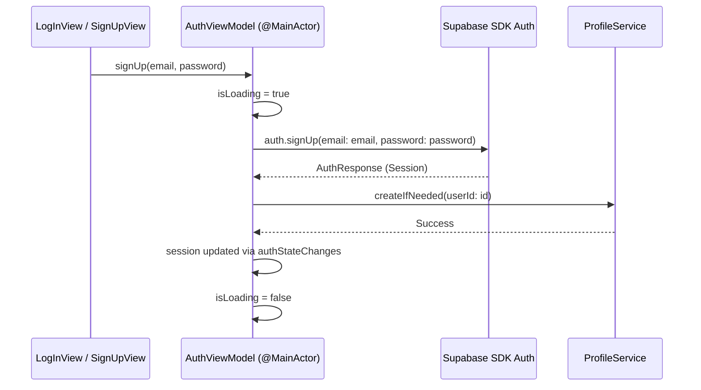
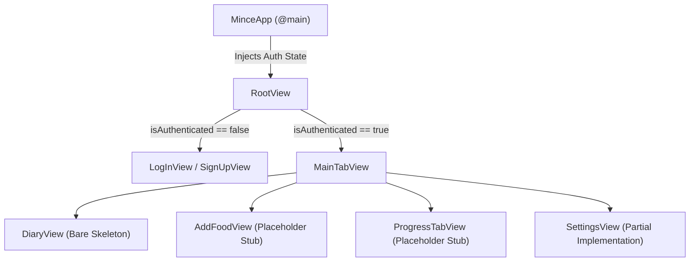

# Mince — Technical Specification

This document serves as the ground-truth technical specification for the `mince` codebase [cite: 1]. It outlines the database schemas, security architectures, application data flows, and active code implementations [cite: 1]. It also provides an explicit inventory of all stubbed logic (`// TODO`) to guide ongoing feature development [cite: 1].

---

## 1. Relational Database Schema

The database relies on four core PostgreSQL tables residing within the `public` schema, all secured with Row Level Security (RLS) [cite: 1]. `auth.users` (managed by Supabase Auth) acts as the root node for all user-owned foreign key chains [cite: 1].

```mermaid
erDiagram
    AUTH_USERS ||--|| PROFILES : "1:1 Extension"
    AUTH_USERS ||--o{ DIARY_ENTRIES : "owns (1:N)"
    AUTH_USERS ||--o{ WEIGHT_LOGS : "owns (1:N)"
    AUTH_USERS ||--o{ FOODS : "creates (1:N, optional)"
    FOODS ||--o{ DIARY_ENTRIES : "referenced by (1:N)"

    AUTH_USERS {
        uuid id PK
    }
    PROFILES {
        uuid id PK_FK
    }
    FOODS {
        uuid id PK
        uuid created_by FK
    }
    DIARY_ENTRIES {
        uuid id PK
        uuid user_id FK
        uuid food_id FK
    }
    WEIGHT_LOGS {
        uuid id PK
        uuid user_id FK
    }
```

### 1.1 `profiles` (`0001_profiles.sql`)

Extends `auth.users` in a strict 1:1 relationship, storing raw user-provided profile input [cite: 1].

| Column | PostgreSQL Type | Constraints | Description |
| :--- | :--- | :--- | :--- |
| `id` | `uuid` | **PK**, `REFERENCES auth.users(id) ON DELETE CASCADE` | Uses the `auth.users` UUID directly rather than a generated ID [cite: 1]. |
| `display_name` | `text` | `NULLABLE` | Optional user handle/display name [cite: 1]. |
| `date_of_birth` | `date` | `NULLABLE` | Used to compute age dynamically [cite: 1]. |
| `sex` | `text` | `NULLABLE`, `CHECK (sex IN ('male', 'female'))` | Biological sex for metabolic formulas [cite: 1]. |
| `height_cm` | `numeric(5,1)` | `NULLABLE` | Height in centimeters [cite: 1]. |
| `weight_kg` | `numeric(5,1)` | `NULLABLE` | Primary weight metric [cite: 1]. |
| `activity_level` | `text` | `NULLABLE`, `CHECK (activity_level IN ('sedentary', 'light', 'moderate', 'active', 'very_active'))` | Used as a maintenance multiplier (TDEE) [cite: 1]. |
| `goal` | `text` | `NULLABLE`, `CHECK (goal IN ('cut', 'maintain', 'bulk'))` | Used for caloric surplus/deficit calculations [cite: 1]. |
| `created_at` | `timestamptz` | `NOT NULL DEFAULT now()` | Row creation timestamp [cite: 1]. |
| `updated_at` | `timestamptz` | `NOT NULL DEFAULT now()` | Row modification timestamp [cite: 1]. |

> **Architectural Note:** Target and maintenance calories are intentionally omitted from persistent storage [cite: 1]. Caloric targets are derived dynamically at runtime via `CalorieCalculator` to prevent data drift whenever a user updates physical metrics [cite: 1].

---

### 1.2 `foods` (`0002_foods.sql`)

Shared nutritional item database [cite: 1]. A `NULL` value in `created_by` indicates a system-wide "seed" food, while populated fields indicate user-submitted custom foods [cite: 1].

| Column Category | Columns & Data Types | Constraints & Defaults |
| :--- | :--- | :--- |
| **Identifiers** | `id` (`uuid`), `created_by` (`uuid`) | `id`: **PK**, `DEFAULT gen_random_uuid()` [cite: 1]<br>`created_by`: **FK** → `auth.users(id) ON DELETE SET NULL` [cite: 1] |
| **Metadata** | `name` (`text`), `brand` (`text`), `serving_size_g` (`numeric(7,2)`), `serving_name` (`text`) | `name`: `NOT NULL` [cite: 1]<br>`serving_size_g`: `NOT NULL DEFAULT 100` [cite: 1]<br>`serving_name`: `NOT NULL DEFAULT 'g'` [cite: 1] |
| **Macros (per 100g)** | `calories_kcal`, `protein_g`, `carbs_g`, `fat_g`, `fiber_g`, `sugar_g`, `saturated_fat_g`, `cholesterol_mg` | `calories_kcal`: `numeric`, `NOT NULL` [cite: 1]<br>All other macros default to `0` [cite: 1] |
| **Micros (per 100g)** | Minerals (`sodium_mg`, `potassium_mg`, etc.), Vitamins (`vitamin_a_mcg`, `vitamin_c_mg`, etc.) | All `numeric`, `NOT NULL DEFAULT 0` [cite: 1] |
| **Timestamps** | `created_at`, `updated_at` (`timestamptz`) | `NOT NULL DEFAULT now()` [cite: 1] |

* **Indexing:** Includes a GIN index `foods_name_search_idx` built on `to_tsvector('english', name)` to support full-text search capabilities [cite: 1].
* **Design Rationale:** Flat columns were selected over an Entity-Attribute-Value (EAV) schema [cite: 1]. Because the nutrient domain is fixed (~28 tracked metrics), a flat row structure optimizes read query performance by avoiding multi-table joins on every fetch [cite: 1].

---

### 1.3 `diary_entries` (`0003_diary_entries.sql`)

Records individual food logs by combining a reference pointer to `foods` with a custom quantity [cite: 1].

| Column | Type | Constraints |
| :--- | :--- | :--- |
| `id` | `uuid` | **PK**, `DEFAULT gen_random_uuid()` [cite: 1] |
| `user_id` | `uuid` | `NOT NULL`, **FK** → `auth.users(id) ON DELETE CASCADE` [cite: 1] |
| `food_id` | `uuid` | `NOT NULL`, **FK** → `public.foods(id) ON DELETE RESTRICT` [cite: 1] |
| `logged_on` | `date` | `NOT NULL DEFAULT current_date` [cite: 1] |
| `meal_type` | `text` | `NOT NULL`, `CHECK (meal_type IN ('breakfast', 'lunch', 'dinner', 'snack'))` [cite: 1] |
| `quantity_g` | `numeric(7,2)` | `NOT NULL`, `CHECK (quantity_g > 0)` [cite: 1] |
| `created_at` | `timestamptz` | `NOT NULL DEFAULT now()` [cite: 1] |

* **Constraints & Indexes:** 
  * `ON DELETE RESTRICT` on `food_id` prevents global foods from being deleted if referenced by existing logs [cite: 1].
  * Composite index `diary_entries_user_day_idx` on `(user_id, logged_on)` optimizes daily view queries [cite: 1].
* **Design Trade-off:** Nutrient snapshots are omitted [cite: 1]. Entries store `quantity_g` and calculate macro values relative to `foods.calories_kcal` dynamically [cite: 1]. If a food item's base macros change, historical logs update automatically [cite: 1].

---

### 1.4 `weight_logs` (`0004_weight_logs.sql`)

Stores daily weight tracking logs [cite: 1].

| Column | Type | Constraints |
| :--- | :--- | :--- |
| `id` | `uuid` | **PK**, `DEFAULT gen_random_uuid()` [cite: 1] |
| `user_id` | `uuid` | `NOT NULL`, **FK** → `auth.users(id) ON DELETE CASCADE` [cite: 1] |
| `logged_on` | `date` | `NOT NULL DEFAULT current_date` [cite: 1] |
| `weight_kg` | `numeric(5,1)` | `NOT NULL` [cite: 1] |
| `created_at` | `timestamptz` | `NOT NULL DEFAULT now()` [cite: 1] |

* **Uniqueness:** A composite unique constraint `UNIQUE (user_id, logged_on)` restricts entries to one weigh-in per user per day and requires updates to use `upsert` (`ON CONFLICT`) [cite: 1].

---

## 2. Row Level Security (RLS) Matrix

Row Level Security is enabled across all tables [cite: 1]. Postgres enforces permission boundaries using the caller's JWT payload via `auth.uid()` [cite: 1].

```
               Client HTTP Request (Bearer JWT)
                              │
                              ▼
                PostgREST / Supabase Gateway
                              │
                              ▼
            PostgreSQL RLS Engine (Database Layer)
        ┌──────────────────────────────────────────┐
        │ Evaluates Policy: auth.uid() == user_id  │
        └────────────────────┬─────────────────────┘
                 ┌───────────┴───────────┐
                 ▼                       ▼
          [ Match: ALLOW ]       [ Fail: DENY (0 rows) ]
```

| Table | `SELECT` Policy | `INSERT` Policy | `UPDATE` Policy | `DELETE` Policy |
| :--- | :--- | :--- | :--- | :--- |
| **`profiles`** | `auth.uid() = id` [cite: 1] | `auth.uid() = id` [cite: 1] | `auth.uid() = id` [cite: 1] | *Denied* (No policy defined) [cite: 1] |
| **`foods`** | `auth.role() = 'authenticated'` [cite: 1] | `auth.uid() = created_by` [cite: 1] | `auth.uid() = created_by` [cite: 1] | `auth.uid() = created_by` [cite: 1] |
| **`diary_entries`** | `auth.uid() = user_id` [cite: 1] | `auth.uid() = user_id` [cite: 1] | `auth.uid() = user_id` [cite: 1] | `auth.uid() = user_id` [cite: 1] |
| **`weight_logs`** | `auth.uid() = user_id` [cite: 1] | `auth.uid() = user_id` [cite: 1] | `auth.uid() = user_id` [cite: 1] | `auth.uid() = user_id` [cite: 1] |

Key Security Rules:
1. **Public Read for Shared Foods:** `foods` read access requires only an `authenticated` role, allowing all signed-in users to search shared food items regardless of author [cite: 1]. Write operations remain restricted to the creator (`created_by`) [cite: 1].
2. **Immutable Profile Rows:** `profiles` intentionally omits a `DELETE` policy [cite: 1]. API client requests cannot delete profile entries directly [cite: 1]. Profiles are removed automatically via cascade when the parent `auth.users` entity is deleted [cite: 1].

---

## 3. Data Models (`Models/`)

Swift data models are defined as `Codable` structs [cite: 1]. `CodingKeys` map Swift's `camelCase` properties to database `snake_case` column names [cite: 1].

* **`Food` (`Food.swift`):** Maps to `foods` [cite: 1]. Provides a fallback client-side `UUID()` on initial local instantiation [cite: 1].
* **`DiaryEntry` / `DiaryEntryWithFood` (`DiaryEntry.swift`):** 
  * `DiaryEntry`: Simple struct used for database writes [cite: 1].
  * `DiaryEntryWithFood`: Nested struct decoding complex PostgREST join payloads (e.g., `.select("id, quantity_g, meal_type, food:foods(*)")`) [cite: 1]. Prevents N+1 database queries by fetching entry and food data in a single payload [cite: 1].
  * `MealType`: String-backed enum (`breakfast`, `lunch`, `dinner`, `snack`) mirroring SQL constraints [cite: 1].
* **`UserProfile` (`UserProfile.swift`):** Maps to `profiles` using string-backed enums (`Sex`, `ActivityLevel`, `Goal`) [cite: 1]. `dateOfBirth` is stored as an ISO `String` (`yyyy-MM-dd`) to avoid timezone shift errors during standard JSON parsing [cite: 1].
* **`MacroTotals` (`MacroTotals.swift`):** Non-persisted transient model holding client-calculated aggregates (`calories`, `proteinG`, `carbsG`, `fatG`, `fiberG`, `sodiumMg`) [cite: 1].

---

## 4. Environment & Services Architecture (`Services/`)

### 4.1 Client Initialization (`SupabaseService.swift`)

Initialization relies on a lazy, thread-safe global singleton pattern [cite: 1]:

```swift
enum SupabaseService {
    static let shared: SupabaseClient = {
        guard let urlString = Bundle.main.object(forInfoDictionaryKey: "SUPABASE_URL") as? String,
              let url = URL(string: urlString),
              let anonKey = Bundle.main.object(forInfoDictionaryKey: "SUPABASE_ANON_KEY") as? String,
              !anonKey.isEmpty else {
            fatalError("Missing Supabase configuration. Check Secrets.xcconfig setup.")
        }
        return SupabaseClient(supabaseURL: url, supabaseKey: anonKey)
    }()
}
```

```
[ Secrets.xcconfig ] ──(Build Sync)──> [ Info.plist Keys ] ──(Runtime Read)──> [ SupabaseService.shared ]
```

Secrets are stored in `Secrets.xcconfig` (excluded from git), exposed via target `Info.plist` key bindings, and fetched at runtime [cite: 1]. Missing or malformed keys trigger a runtime fatal error [cite: 1].

---

### 4.2 Auth Execution Engine (`AuthViewModel.swift`)

State updates are bound to `@MainActor` to ensure UI synchronization [cite: 1]. The session lifecycle streams auth state updates directly [cite: 1]:

```swift
private func observeAuthState() async {
    for await state in client.auth.authStateChanges {
        self.session = state.session
    }
}
```

 Authentication operations execute asynchronous pipelines [cite: 1]:



---

## 5. UI Architecture and Router Patterns

App UI follows a strict MVVM pipeline [cite: 1]. Views consume ViewModels via environment objects and do not run data layer queries directly [cite: 1].



* **`RootView` Router:** Reads `isAuthenticated` from `AuthViewModel` to toggle between unauthenticated auth views and the main tab bar container [cite: 1].
* **`DiaryView`:** Contains functional data fetching through `.task {}` hooks, rendering daily entries and totals [cite: 1]. Detailed UI controls (such as editing or meal sections) remain stubbed [cite: 1].

---

## 6. Comprehensive Implementation Inventory

This matrix tracks current implementation states across the codebase [cite: 1]:

| Class / Component | Method / Feature | Status | Remaining Task / Implementation Details |
| :--- | :--- | :--- | :--- |
| **`CalorieCalculator`** | `maintenanceCalories()` | 🔶 **Stubbed** | Calculate Mifflin-St Jeor equation using height, weight, age, and biological sex [cite: 1]. |
| **`CalorieCalculator`** | `targetCalories()` | 🔶 **Stubbed** | Apply surplus or deficit multipliers to calculated maintenance calories based on user goals [cite: 1]. |
| **`MacroTotals`** | `from(_ entries:)` | 🔶 **Stubbed** | Scale per-100g base macros by `quantity_g / 100` and sum total values [cite: 1]. |
| **`AuthViewModel`** | `signUp()` | ⚠️ **Partial** | Add local client-side validation (email syntax checking, minimum password lengths) [cite: 1]. |
| **`FoodService`** | `search(query:)` | 🔶 **Stubbed** | Replace default limit queries with `to_tsvector` text searches utilizing `foods_name_search_idx` [cite: 1]. |
| **`DiaryView`** | Meal Sections & Layout | ⚠️ **Partial** | Implement section groupings by meal type, per-entry macro breakdowns, and swipe-to-delete gestures [cite: 1]. |
| **`AddFoodView`** | Search & Custom Food Form | 🔶 **Stubbed** | Build search interface components and custom food submission forms [cite: 1]. |
| **`ProgressTabView`** | Weight Analytics | 🔶 **Stubbed** | Build interactive SwiftCharts visualization using historical `weight_logs` data [cite: 1]. |
| **`SettingsView`** | Profile Management | ⚠️ **Partial** | Implement forms to update user metrics (`height_cm`, `weight_kg`, `goal`) [cite: 1]. |
| **`BarcodeScannerService`** | Hardware Integration | 🔷 **Interface Only** | Provide AVFoundation scanner implementations conforming to protocol standards [cite: 1]. |
| **`FoodPhotoEstimationService`**| Image Recognition API | 🔷 **Mocked** | Replace `MockFoodPhotoEstimationService` with production machine learning models [cite: 1]. |

---

## 7. Development Path to Milestone Completion

To bring the initial prototype to a fully functional state, updates should be completed in the following execution order [cite: 1]:

```
┌─────────────────────────────────────────────────────────────────────────────┐
│ 1. Implement MacroTotals.from(_:)                                           │
│    Enables correct recalculation of macro totals when logging food items.   │
└─────────────────────────────────────┬───────────────────────────────────────┘
                                      │
                                      ▼
┌─────────────────────────────────────────────────────────────────────────────┐
│ 2. Implement FoodService.search(query:)                                     │
│    Connects full-text search capabilities to the database index.            │
└─────────────────────────────────────┬───────────────────────────────────────┘
                                      │
                                      ▼
┌─────────────────────────────────────────────────────────────────────────────┐
│ 3. Build AddFoodView Navigation and UI Layout                               │
│    Provides an interface to search foods and create new diary entries.      │
└─────────────────────────────────────┬───────────────────────────────────────┘
                                      │
                                      ▼
┌─────────────────────────────────────────────────────────────────────────────┐
│ 4. Implement CalorieCalculator and Update SettingsView                      │
│    Completes metabolic calculations and profile update workflows.           │
└─────────────────────────────────────────────────────────────────────────────┘
```